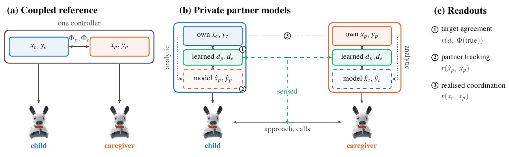

# AttachmentNN

Robot controllers, simulated robot experiments, recorded runs and analyses for a coupled-oscillator model of attachment running on a dyad of MiRo robots, a child and a caregiver.

In the coupled-oscillator model of attachment [1], care-seeking and caregiving are motivational oscillators. They are coupled through a physical and an emotional distance, weighted by avoidance (ε<sub>Av</sub>) and ambivalence (ε<sub>Am</sub>). In that model both distances are computed from the two partners' internal needs, which neither robot could sense. This project grounds the coupling in what each robot can sense:
- each robot integrates its own oscillator and a private model of its partner;
- neural networks estimate the coupling terms from the robot's own state and, in some variants, from the sensed distance and calls.

The evaluation keeps three readouts apart:
- agreement of the estimates with the coupling targets;
- tracking of the partner by the partner model;
- coordination between the robots' own needs.

<p align="center"></p>

*(a) Coupled reference: one controller integrates both needs and computes the coupling from both. (b) Private partner models: each robot integrates its own state and a model of its partner, driven by learned coupling estimates. Dashed: sensed distance and calls (Observed variants). Dotted: analytic propagation of the partner model (Baseline variants). (c) The three readouts.*

The main findings, reported in a manuscript in preparation for *IEEE Transactions on Cognitive and Developmental Systems*:
- **The regimes are visible.** The model's regimes leave distinct signatures in distance and vocal exchange.
- **Learned open-loop estimates fail to keep the robots coordinated.** Each controller stays internally coordinated while the robots' rhythms drift apart, and close agreement with the coupling targets coexists with poor partner tracking.
- **Analytic propagation restores tracking without perception.** Propagating the partner model analytically, with networks trained for each role, restores tracking and partial coordination. It works because both private copies start from the same state.

## Contents

| Path | Content |
|---|---|
| `ros/Attachment-Model/` | ROS Noetic package `attachment_model`: robot nodes, the attachment controllers, the trained coupling networks (`src/*.pth`) and their training notebook, the Gazebo world |
| `ros/Attachment-Model/data/` | Recorded runs, one `experiment_data_{index}/` folder per run |
| `experiments/` | Run lists of the Gazebo batches, the parallel batch runner, and the manifests that map each run to its data folder |
| `analysis/` | Loading (`load.py`) and behavioural measures (`metrics.py`) of the recorded runs |
| `analysis/tcds/` | The paper's analyses: scripts, `results/`, `figures/` (PDF) and `tables/` |
| `figures/architecture/` | TikZ sources of the architecture diagrams (the concept figure above and the controller diagram) |
| `archive/` | Code the paper does not use (see [Archive](#archive)) |
| `run_docker.bash`, `save_docker.bash` | Start the ROS container; save it to the image |

## Setup

Everything runs in the Docker image `aung9htet/ubuntu-20.04:miro`. It contains:
- Ubuntu 20.04, ROS Noetic, Gazebo 11 and the MiRo developer kit (release 230105);
- a Python 3.8 environment at `/workspace/.venv` with NumPy, SciPy, Matplotlib, scikit-learn and PyTorch.

1. **Install Docker:** [Docker Engine](https://docs.docker.com/engine/install/) and the [post-installation steps](https://docs.docker.com/engine/install/linux-postinstall/). For the robots' camera rendering on a GPU, also install the [NVIDIA Container Toolkit](https://docs.nvidia.com/datacenter/cloud-native/container-toolkit/latest/install-guide.html).
2. **Start the ROS container** (X11 forwarding, GPU, host network):
   ```bash
   ./run_docker.bash      # creates ros_container, or opens a shell in it if it exists
   ```
   - The package is mounted at `/root/mdk/catkin_ws/src/Attachment-Model` and `analysis/` at `/root/analysis`, so recorded runs land in this repository.
   - A `ros_container` created before these mounts existed must be removed once: `docker rm -f ros_container`.
3. **Build the package in the container** if it is not built yet:
   ```bash
   cd /root/mdk/catkin_ws && catkin build attachment_model && source devel/setup.bash
   ```
4. **Save the container** with `./save_docker.bash`. This commits the container to the image and overwrites it.

The analyses need no ROS. From the repository root, this shell function runs any script in the image:

```bash
py() { docker run --rm --user "$(id -u):$(id -g)" -e HOME=/tmp -e MPLCONFIGDIR=/tmp \
         -v "$PWD:/repo" -w /repo aung9htet/ubuntu-20.04:miro /workspace/.venv/bin/python -W ignore "$@"; }
```

## The model

Each agent *i* ∈ {*c*, *p*} (child, caregiver) has two states:
- a fast need *x<sub>i</sub>*: it approaches its partner when *x<sub>i</sub>* > 0 and explores when *x<sub>i</sub>* < 0;
- a slow accumulated need *y<sub>i</sub>*.

The robot controllers integrate

$$\dot x_i = 2x_i - 4x_i^3 - y_i,$$

$$\dot y_c = b'x_c - \varepsilon_{Am}(y_c + y_p - d_p) - \varepsilon_{Av}(y_p - y_c - d_e),\qquad
\dot y_p = b'x_p - \varepsilon_{Am}(y_c + y_p + d_p) - \varepsilon_{Av}(y_p - y_c - d_e),$$

with *b′* = 0.7. Integration is fourth-order Runge–Kutta at 30 control ticks per second, with *h* = 0.01 of model time per tick. The two distances differ by controller:
- **Coupled reference:** *d<sub>p</sub>* and *d<sub>e</sub>* are computed from both true accumulated needs, as *d<sub>p</sub>* = ½(*y<sub>c</sub>* + *y<sub>p</sub>*) + *y<sub>c</sub>* and *d<sub>e</sub>* = *k*<sub>0</sub>(½(*y<sub>c</sub>* − *y<sub>p</sub>*) + *y<sub>c</sub>*) + *k*<sub>0</sub>δ, with *k*<sub>0</sub> = 0.8 and δ = 0.1.
- **Private-model controllers:** networks estimate them from the robot's own state and either internal or sensed inputs.

| Form of the model | Code |
|---|---|
| Robot controllers (all variants) | `ros/Attachment-Model/src/attachment_model_control.py` |
| The same controllers outside ROS, vectorised | `analysis/tcds/model.py`; the networks are read without PyTorch by `nnweights.py` |
| Canonical model, analysed for its regimes (*ẋ* = *x* − 2*x*³ − *y*, time scale μ = 0.1) | `analysis/tcds/canonical.py` |
| Agent-based strange situation in which the networks were trained | `ros/Attachment-Model/src/attachment_with_nn.ipynb`, re-implemented in `analysis/tcds/sim_agents.py` |
| Kinematic stand-in of the Gazebo experiment (inverse study) | `analysis/tcds/sim_kinematic.py` |

## Experiments

### Controller variants

The launch arguments `controller`, `distance` and `networks` select the variant:

| Variant | Launch settings | Partner model | Inputs of the learned distances |
|---|---|---|---|
| Coupled reference | `controller:=coupled` | none: one integrator holds both robots' true needs | none (analytic distances) |
| Decoupled | `controller:=decoupled` (default) | learned distances | internal need gap, silent calls; both robots load the caregiver's networks |
| Observed | `controller:=observed distance:=gt` (`odom` for odometry) | learned distances | sensed distance and calls; each robot loads its own networks |
| Baseline | `controller:=baseline` | analytic distances on the private copy | internal need gap, silent calls; the caregiver's networks |
| Baseline-observed | `controller:=baseline-observed distance:=gt` | analytic distances on the private copy | sensed distance and calls; own networks |
| Notebook | `controller:=notebook distance:=gt` | none: own need only, with the training simulator's equations | sensed distance and calls; own networks |
| Decoupled or Baseline, own networks | `networks:=own` with `decoupled` or `baseline` | as above | each robot loads its own networks (network-assignment ablation) |

### One run

In the container:

```bash
roslaunch attachment_model relationship.launch avoidant:=0.0 ambivalent:=0.2 duration:=180 \
    controller:=decoupled seed:=1 initial:=random
```

| Argument | Default | Meaning |
|---|---|---|
| `avoidant`, `ambivalent` | `0.0` | ε<sub>Av</sub> (emotional-distance coupling) and ε<sub>Am</sub> (physical-distance coupling), 0 to 1 |
| `duration` | `0` | Run length in simulated seconds; `0` runs until Ctrl+C |
| `controller` | `decoupled` | Controller variant (table above) |
| `distance` | `gt` | Sensed distance for `observed`, `baseline-observed` and `notebook`: `gt` (Gazebo ground truth) or `odom` |
| `networks` | `default` | `own`: `decoupled` and `baseline` load each robot's own networks instead of the caregiver's |
| `seed` | `-1` | Seed of the random exploration and of random starting needs; `-1` leaves both unseeded |
| `initial` | empty | Starting needs: empty for (−1, 1, −1, 1), `random` (needs a seed), or four numbers |
| `batch` | empty | Label stored in `meta.json` |
| `gui` | `true` | Show the Gazebo client and the camera preview |

**What the launch file starts:**
- **World:** Gazebo with `worlds/attachment.world`, a 2.61 m arena centred on the caregiver's 0.3 m box, which has an AprilTag on each face.
- **Nodes:** `child_node.py`, `parent_node.py`, `attachment_model_control.py`, `perception.py`, `camera_recording.py` and `experiment_timer.py`.

**What the robots do:**
- The child explores by a random walk while its need is negative, and steers to the caregiver's tags while it is positive.
- The caregiver stays on its box.
- Both robots call on a simulated channel.

When the run ends, everything is saved to the next free `data/experiment_data_{index}/`.

### Batches

Every Gazebo run in the paper comes from one of three run lists in `experiments/`. Unless stated otherwise, runs last 180 s.
- **Strips:** the origin plus 0.1–0.9 on each parameter axis with the other at zero (19 conditions).
- **Random starts:** starting needs drawn from the seed, so seed *s* gives the same start for every controller.
- **Identical start:** (−1, 1, −1, 1).

| Batch | Variant | Conditions | Starts (seeds) | Runs | List → data folders |
|---|---|---|---|---|---|
| E1s | Decoupled | strips | identical (101–103) | 57 | `tcds_runs.csv` → 54–496 |
| E1r | Decoupled | strips | random (1–5) | 95 | 〃 |
| E2 | Coupled reference | strips | random (1–3), identical (101) | 76 | 〃 |
| E3 | Decoupled, Coupled reference | six off-axis pairs | random (1–3) | 36 | 〃 |
| E4 | Decoupled, Coupled reference | ε<sub>Av</sub> = 0.2 or ε<sub>Am</sub> = 0.2, 900 s | random (1–2) | 8 | 〃 |
| E5a | Observed (ground truth) | strips | random (1–3) | 57 | 〃 |
| E5b | Observed (odometry) | strips | random (1–3) | 57 | 〃 |
| E5c | Notebook | strips | random (1–3) | 57 | 〃 |
| E6a | Baseline | strips | random (1–3) | 57 | `tcds_runs_e6.csv` → 497–610 |
| E6b | Baseline-observed | strips | random (1–3) | 57 | 〃 |
| E7a | Decoupled, own networks | strips | random (1–3) | 57 | `tcds_runs_e7.csv` → 611–724 |
| E7b | Baseline, own networks | strips | random (1–3) | 57 | 〃 |

**Earlier recordings in the same folder:**
- **D0, runs 34–53:** the first runs with robot paths, all with the Decoupled controller from the identical start. They are:
  - three regimes of 300 s: secure (ε<sub>Am</sub> 0.1), strongly avoidant (ε<sub>Av</sub> 0.9) and moderately ambivalent (ε<sub>Am</sub> 0.4);
  - sweeps of each parameter from 0.1 to 0.8 at 180 s;
  - the origin.

  They were recorded with `archive/model/ros/run_experiments.sh` and are included in `gazebo_runs.csv`. The paper's arena figure uses a frame of run 34.
- **Runs 0–33:** no robot paths and no `meta.json`.
  - Runs 0–16 (180 s each) were recorded as training data; runs 17–33 last 60 s.
  - In these runs the controller applied the two parameters the wrong way round: the value labelled *avoidant* drove the ambivalent coupling. `analysis/load.py` corrects the labels.

**To regenerate and record the batches:**

```bash
python3 experiments/make_runs.py                                         # writes the three run lists (stdlib only)
python3 experiments/run_batch.py experiments/tcds_runs.csv --workers 5   # host side; needs Docker, an X display and ideally a GPU
py analysis/tcds/check_runs.py                                           # replay every run against its controller
```

- **How `run_batch.py` runs:** each worker is its own `docker run` of the image, with its own ROS master. Finished runs are moved to the next free data folder.
- **Resuming:** attempts are logged to `experiments/work/manifest_<list>.csv`, so an interrupted batch resumes when rerun.
- **Tracked manifests:** `experiments/manifest_tcds_runs*.csv` record the paper's batches, mapping each run id to its folder index.

### Recorded data

| File | Content |
|---|---|
| `meta.json` | Parameters, controller, distance, networks, seed, starting needs, batch, durations, arena geometry (from run 34) |
| `child_data.npy`, `parent_data.npy` | NumPy dictionaries sampled at 10 Hz (keys below) |
| `controller_child.npy`, `controller_parent.npy` (`controller_central.npy` for the coupled reference) | Each controller's state, inputs and coupling estimates at every tick (from run 54) |
| `camera_recording.mp4` | Overhead video |

```python
{
    'Xc', 'Xp',                                      # child / caregiver [need, accumulated need]
    'ambivalence', 'avoidance',                      # parameter values
    'physical_coupling_targets', 'emotional_coupling_targets',
    'child_states', 'parent_states',                 # action: 0 approach, 1 explore
    'vocal_child', 'vocal_parent',                   # calls
    'child_evidence_trace', 'parent_evidence_trace', # vocal evidence accumulation
    # from run 34 on:
    'time',                                          # simulated time (s)
    'child_odom', 'parent_odom',                     # odometry [x, y, yaw] in the world frame
    'child_odom_raw', 'parent_odom_raw',             # odometry as published (robot frame)
    'child_gt', 'parent_gt',                         # Gazebo ground-truth position [x, y] (m)
    'odom_distance', 'gt_distance',                  # child-caregiver distance (m)
    'odom_distance_norm', 'gt_distance_norm',        # min(1, distance / arena size)
}
```

**Data notes:**
- **Arena:** 2.61 m wide, centred on the caregiver box at (0.325, 0.325).
- **Odometry:** wheel odometry drifts by a median 1.06 m per run, so the analyses use ground-truth distances.
- **What is in git:** `meta.json` for every run from 34 on, plus the arrays and videos of runs 0–53. The arrays and videos of runs 54–724 (about 6.7 GB) are not in the repository because of their size.

### Training the networks

`ros/Attachment-Model/src/attachment_with_nn.ipynb` trains the four coupling networks: physical and emotional distance, for the child and for the caregiver.
- **Training data:** the agent-based strange situation, against the analytic coupling targets. Only the zero-coupling condition uses a recorded Gazebo run; the others are simulated.
- **Output:** the `.pth` files next to the notebook, which the controllers load.
- **How to run it:** in Jupyter in the container; PyTorch is in `/workspace/.venv`.
- **Evaluation:** `analysis/tcds/estimator_eval.py` evaluates the trained networks in the re-implemented simulator.
- **Full training details:** the paper's supplementary material.

## Reproducing the paper

Run the scripts from the repository root with `py`, in the order below. Their outputs go to `analysis/tcds/results/`, `figures/` and `tables/`, which are all in git, so any step can be rerun on its own.

Steps marked **raw** read the arrays of runs 54 onwards.

| # | Command | Computes | Writes (`analysis/tcds/…`) | Paper |
|---|---|---|---|---|
| 1 | `py analysis/tcds/canonical.py` | Regimes of the canonical model and of the controllers' form: strips, plane, bifurcation diagrams, steady states | `results/canonical*.npz` | Fig. 2; S2 |
| 2 | `py analysis/tcds/ssp_sim.py` | Simulated strange situation, five regimes | `results/sim_ssp.npz` | Fig. 3; S3 |
| 3 | `py analysis/tcds/explore.py` | Coupled vs Decoupled controller along the strips, including the identical start | `results/explore_*.npz` | Fig. 4 |
| 4 | `py analysis/tcds/robustness.py` | Random starts, plane, identical-start stability, network and notebook ablations | `results/robust_*.npz` | Fig. 4; S2, S5 |
| 5 | `py analysis/tcds/estimator_eval.py` | Accuracy and input ablations of the learned distances in the training simulator | `results/estimator_eval.npz` | S5 |
| 6 | `py analysis/tcds/check_runs.py` (raw) | Replays every Gazebo run against its controller | `results/run_checks.csv` | S8 |
| 7 | `py analysis/tcds/gazebo.py` (raw) | Per-run measures: the three readouts, regimes, behaviour, calls | `results/gazebo_runs.csv` | Figs. 4–6; S5, S6 |
| 8 | `py analysis/tcds/inverse.py` (raw) | Kinematic stand-in runs and the inverse problem | `results/inverse.npz` | Table I; S6, S7 |
| 9 | `py analysis/tcds/calibration.py` (raw) | Stand-in speed calibrated on runs outside the test set | `results/calibration.json` | Table I; S6 |
| 10 | `py analysis/tcds/paper_numbers.py` (raw) | Every number quoted in the paper | `results/numbers.json`, `tables/*.tex` | text, Table I, S tables |
| 11 | `py analysis/tcds/figures.py [names]` | Every plotted figure. Raw runs are needed for the controller logs, the 900 s runs, the exemplars and odometry | `figures/fig_*.pdf` (+ PNG previews) | Figs. 2–6, supplement |
| — | `figures/architecture/build.sh` | Architecture diagrams (needs TeX Live, e.g. the `texlive/texlive` image; usage in the script) | `figures/architecture/fig_*.pdf` | Fig. 1, Fig. S1 |

Notes:
- **Run order:** steps 1–9 depend only on the code, plus the recorded runs where marked. `paper_numbers.py` and `figures.py` read their results, so run them last.
- **Supplement numbering:** S2–S8 are the sections of the supplementary material (S2 model forms, S3 simulated strange situation, S5 learned estimates, S6 robot behaviour, S7 inverse study, S8 runs and validation).
- **The physical-robot strange situation** (paper Section IV, S4) was recorded with a separate physical setup. Those recordings are not in this repository.
- **Known nondeterminism:** `fig_maps` (supplement S2) marks the majority regime of the Gazebo runs at each parameter pair. Where the runs tie, the marker it picks can change between runs, so this one figure is not byte-reproducible.

## Archive

`archive/` keeps code the paper does not use. The code is in git; its outputs, the papers and the notes stay local (`.gitignore`).

| Path | Content | In git |
|---|---|---|
| `archive/model/ros/` | `plot_graph.py` (a live plot of the needs, never started by the launch file), `read_recorded_data.py` (loader of the early runs, replaced by `analysis/load.py`), `run_experiments.sh` (recorded runs 34–53) | yes |
| `archive/model/experiments/` | The 60 s pilot runs that preceded the batches: `make_pilot_runs.py`, run lists, manifests; `pilot_data/` and the batch and per-run `logs/` | code and lists only |
| `archive/analysis/npj_figures/` | `make_figures.py`: npj-style robot figures and proximity statistics of runs 34–53 | code only |
| `archive/analysis/extra_figures.py` | A Gazebo timeline figure not used in the paper | code only |
| `archive/analysis/logs/` | Logs of earlier `robustness.py` and `estimator_eval.py` runs | no |
| `archive/papers/`, `archive/docs/` | Paper drafts, earlier papers and planning notes | no |

## Reference

[1] A. Htet, A. Jimenez-Rodriguez, M. Gagliardi and T. J. Prescott, "A coupled-oscillator model of human attachment dynamics evaluated in a robot dyadic interaction," in *Biomimetic and Biohybrid Systems* (Living Machines 2024), LNAI 14930, Springer, 2024, pp. 52–67.
